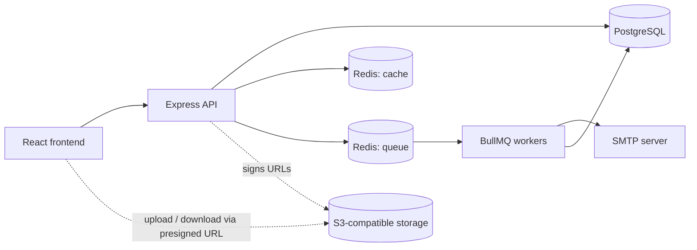

# HireFlow API

Backend for **HireFlow**, a job portal with three roles: candidates, recruiters and admins. It covers authentication, job posting and search, applications, resume uploads, notifications, caching and rate limiting.

Frontend repository: [hireflow-frontend](https://github.com/ANJ-NISH/hireflow-frontend.git)


## Features

**Candidates**
- Register, log in, verify email, reset password
- Profile with skills, experience, education, certifications, projects and languages
- Upload up to 5 resumes (PDF or Word, max 5 MB) and choose one when applying
- Search jobs by keyword, location, work mode, employment type and skill, with pagination
- Apply with a cover letter, withdraw, and track an application through its pipeline
- Save jobs, and receive in-app and email notifications

**Recruiters**
- Company profile, then create, edit, publish, pause, close and delete jobs
- Review applicants, view candidate profiles and download resumes
- Move applications through `APPLIED → SCREENING → SHORTLISTED → INTERVIEW → OFFERED → HIRED` (or `REJECTED`)
- Private notes on applications, interview scheduling, and candidate search by skill, location and experience

**Admins**
- Suspend and unsuspend users, approve or revoke companies, remove jobs
- Handle complaints and view platform statistics

## Tech stack

| Area | Technology |
|---|---|
| Runtime and language | Node.js, TypeScript (ES modules) |
| Framework | Express |
| Database | PostgreSQL with Prisma |
| Validation | Zod |
| Auth | JWT access tokens, rotating refresh tokens, bcrypt |
| Queues and cache | Redis, BullMQ, ioredis |
| File storage | S3-compatible storage with presigned URLs (s3rver locally) |
| Email | Nodemailer (SMTP, or console logging in development) |
| Tooling | Docker Compose, tsx |

## Architecture



The API and the workers are separate processes. They communicate only through Redis. There are two Redis instances: the queue one runs with `noeviction` so jobs are never lost, and the cache one runs with `allkeys-lru` and no persistence.

## Engineering highlights

- **Token handling:** 15-minute access tokens, plus 7-day refresh tokens in `httpOnly` cookies. Refresh tokens rotate on every use and are stored only as SHA-256 hashes. Password reset and account suspension revoke all sessions.
- **Race-condition fixes:** atomic `upsert` and `deleteMany` for get-or-create and token rotation, so concurrent requests can't crash or double-process.
- **Direct-to-storage uploads:** the API issues short-lived presigned URLs, so file bytes never pass through the server. After the upload, it verifies the real object with `HeadObject` before saving metadata.
- **Background work:** emails go through a BullMQ queue with retries and exponential backoff. Interview reminders are delayed jobs that re-check the interview's state before sending.
- **Caching:** cache-aside for job search, job details and admin stats, with versioned keys for one-step invalidation and single-flight rebuilds to prevent stampedes. If Redis is down, requests fall back to PostgreSQL.
- **Rate limiting:** Redis fixed-window counters updated by an atomic Lua script, with per-IP, per-account and per-user limits and an in-memory fallback. Responses include `RateLimit-*` and `Retry-After` headers.
- **Security habits:** identical errors for unknown email and wrong password, escaped user text in email HTML, ownership checks on every recruiter and candidate resource, and Zod validation on all inputs.
- **Fail-open design:** the cache, the queue and the notification system never fail the request that triggered them.

## Getting started

### Prerequisites

- Node.js 20 or newer
- PostgreSQL running locally, with an empty database (for example `hireflow`)
- Docker Desktop (for Redis)

### Setup

```bash
git clone https://github.com/ANJ-NISH/hireflow-backend.git
cd hireflow-backend
npm install
cp .env.example .env        # Windows: copy .env.example .env
```

Fill in `.env`. Generate each JWT secret with:

```bash
node -e "console.log(require('crypto').randomBytes(64).toString('hex'))"
```

Start the services and the database schema:

```bash
npm run redis:up            # queue Redis (6379) and cache Redis (6380)
npm run s3                  # local S3, keep this terminal open
npx prisma migrate dev      # create the database tables
```

Run the API and the worker, each in its own terminal:

```bash
npm run dev                 # API on http://localhost:5000
npm run worker              # background worker
```

Check that it's running: `GET http://localhost:5000/api/health`.

### Notes for local development

- With no SMTP settings, emails are printed to the worker terminal instead of being sent.
- With `CACHE_REDIS_URL` unset, caching is disabled and everything still works.
- Set `RATE_LIMIT_ENABLED="false"` when you need to hammer an endpoint during testing.
- Set `INTERVIEW_REMINDER_LEAD_MINUTES=1` to see an interview reminder fire within minutes.
- **Creating an admin:** there's no public admin signup. Register a normal user, run `npx prisma studio`, change that user's `role` to `ADMIN`, then log in again.

## Environment variables

| Variable | Description |
|---|---|
| `DATABASE_URL` | PostgreSQL connection string |
| `PORT` | API port (default 5000) |
| `FRONTEND_URL` | Used to build links in emails |
| `JWT_SECRET`, `JWT_REFRESH_SECRET` | Two different long random strings |
| `SMTP_HOST`, `SMTP_PORT`, `SMTP_USER`, `SMTP_PASS`, `EMAIL_FROM` | Optional in development |
| `S3_ENDPOINT`, `S3_PUBLIC_ENDPOINT`, `S3_REGION`, `S3_ACCESS_KEY_ID`, `S3_SECRET_ACCESS_KEY`, `S3_BUCKET`, `S3_FORCE_PATH_STYLE` | File storage |
| `REDIS_URL` | Queue Redis |
| `CACHE_REDIS_URL` | Cache Redis (optional) |
| `RATE_LIMIT_ENABLED` | `false` disables rate limiting |
| `TRUST_PROXY` | Number of reverse proxies in front of the API |
| `INTERVIEW_REMINDER_LEAD_MINUTES` | How long before an interview the reminder fires (default 1440) |

## API overview

| Area | Base path | Access |
|---|---|---|
| Auth | `/api/auth` | Public |
| Jobs (search, details) | `/api/jobs` | Public |
| Jobs (manage) | `/api/jobs` | Recruiter |
| Companies | `/api/companies` | Recruiter |
| Applications | `/api/applications` | Candidate and recruiter |
| Candidate profile | `/api/candidates` | Candidate (own), recruiter (read) |
| Resumes | `/api/resumes` | Candidate |
| Saved jobs | `/api/saved-jobs` | Candidate |
| Recruiter tools | `/api/recruiter-tools` | Recruiter |
| Notifications | `/api/notifications` | Any logged-in user |
| Complaints | `/api/complaints` | Any logged-in user |
| Admin | `/api/admin` | Admin |

Protected routes expect an `Authorization: Bearer <accessToken>` header.

## Project structure

```
src/
  app.ts          Express app and route mounting
  worker.ts       BullMQ worker process entry point
  controllers/    Request handlers
  routes/         Route definitions
  schemas/        Zod validation schemas
  middlewares/    Auth, role checks, rate limiting, error handler
  services/       Notifications, job cache invalidation
  queues/         Queue definitions and producers
  workers/        Email and interview-reminder workers
  lib/            Prisma, Redis, cache, S3, rate-limit store
  utils/          JWT, mailer, formatting helpers
prisma/           Schema and migrations
docker-compose.yml   Queue Redis and cache Redis
s3-cors.xml          CORS rules for the local bucket
```

## Status and limitations

Not built yet: automated tests (Jest and Supertest), audit logs, a granular permission system (access is role-based plus ownership checks), CI/CD and deployment. Notifications are fetched by polling rather than pushed in real time. Job search uses case-insensitive matching rather than PostgreSQL full-text search.

## Author

Anurag Joshi
